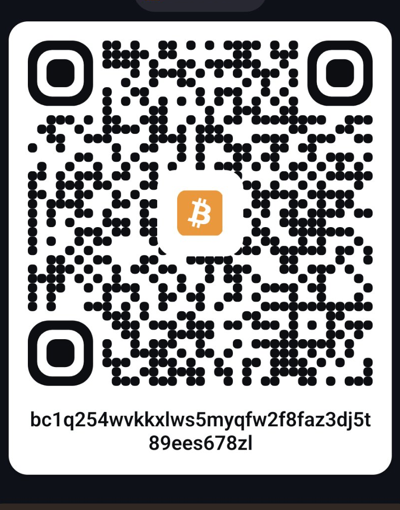
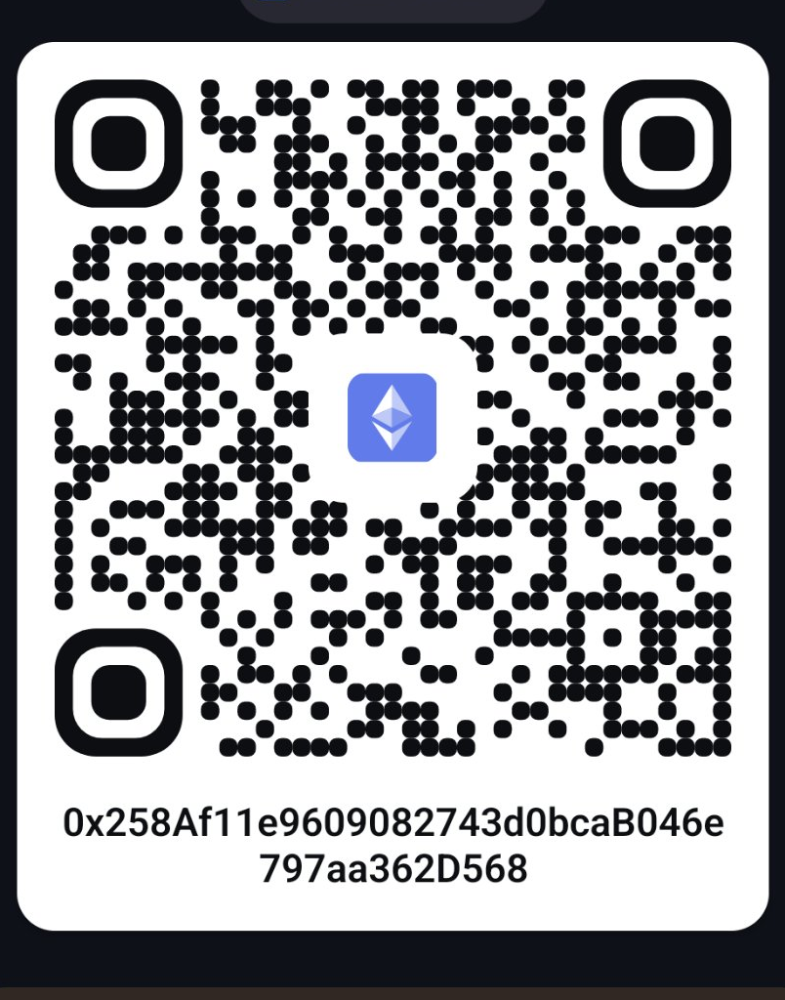
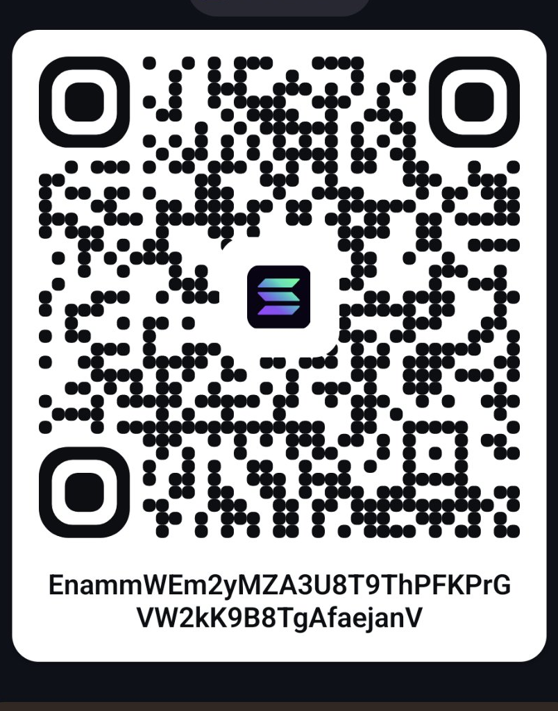

# Supporting NeuroFlipper

NeuroFlipper is free and open source. If it made your Flipper a little more
alive, a tip is appreciated — it goes toward hardware for testing and
keeping the project maintained.

## 🇧🇧 BiMPay (Barbados)

BiMPay is the primary tip option.

- **BiMPay tag/number:** `YOUR_BIMPAY_TAG`
- Or scan the QR code:


> **Setup note for the maintainer:** replace `YOUR_BIMPAY_TAG` above with the
> real BiMPay tag/number, and drop the real QR image at
> `docs/assets/bimpay-qr.png` (PNG, ~400×400). The README's Support block
> points here.

## Crypto

Scan the QR or copy the address. Please send only the matching asset to each
address — anything else will be lost.

### Bitcoin (BTC)



```
bc1q254wvkkxlws5myqfw2f8faz3dj5t89ees678zl
```

### Ethereum (ETH)



```
0x258Af11e9609082743d0bcaB046e797aa362D568
```

### Solana (SOL)



```
EnammWEm2yMZA3U8T9ThPFKPrGVW2kK9B8TgAfaejanV
```

## Other options

- **PayPal:** `YOUR_PAYPAL_LINK`

Every contribution — code, bug reports, new moods — counts as support too.
See [PLAYGROUND](docs/PLAYGROUND.md) to add a behavior.
